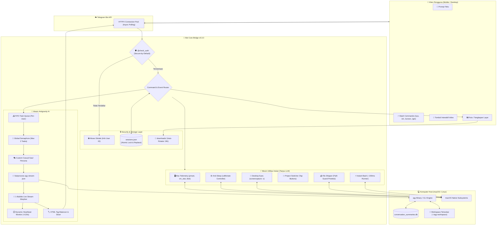

# Antigravity CLI (`agy`) - Telegram Bot Bridge `v0.4.0`

<p align="center">
  <a href="README.md">English</a> •
  <b>Bahasa Indonesia</b>
</p>

<p align="center">
  <a href="https://github.com/fritzuu/agy-telegrambot/releases"></a>
  <a href="https://www.python.org/"></a>
  <a href="LICENSE"></a>
  <a href="https://github.com/fritzuu/agy-telegrambot/issues"></a>
  <a href="https://t.me/BotFather"></a>
</p>

Bridge cerdas dua arah untuk menghubungkan percakapan **Telegram** langsung dengan **Google Antigravity CLI (`agy`)**. Memungkinkan Anda mengontrol, memprogram, dan berdiskusi dengan AI coding agent Antigravity langsung dari Telegram (ponsel maupun desktop) secara persisten, aman, dan interaktif.

---

## 🏛️ Arsitektur & Alur Kerja Sistem (v0.3.0)



---

## 🌟 Fitur Utama (v0.4.0)

### 🎙️ 1. Voice Note to Action (Faster-Whisper STT Engine)
Navigasi dan coding tanpa ngetik saat di jalan, nyetir, atau rebahan:
- **Input Suara & Rekaman Audio**: Kirim Voice Note Telegram (`.ogg/.oga` Opus) atau file audio langsung.
- **100% Offline & Privat**: Transkrip lokal di Apple Silicon menggunakan `faster-whisper` (kuantisasi `int8`) tanpa mengirim audio ke cloud pihak ketiga.
- **Visual STT Quote Bubble**: Menampilkan bubble kutipan teks hasil transkrip sehingga kamu selalu tahu apa yang didengar bot sebelum dieksekusi.
- **Hands-Free Session Reset**: Ucapkan kata kunci reset (misal: *"reset sesi"*, *"new session"*) ke mikrofon untuk mereset konteks secara hands-free.

### 📱 2. Mobile Companion Suite (Away-from-Mac)
Dirancang khusus untuk kenyamanan penggunaan saat Anda sedang di luar, komuter, atau jauh dari laptop:
- **Mac Telemetry Hub (`/sys` atau `/status`)**: Pantau persentase baterai, status charging/discharging, estimasi daya tersisa, pemakaian RAM fisik, sisa kapasitas SSD, CPU load average (1/5/15m), dan uptime Mac.
- **Anti-Sleep Controller (`/caffeinate [on/off]`)**: Jaga Mac Anda agar tidak sleep saat ditinggal bepergian.
- **Remote Desktop Eyes (`/screen` atau `/screenshot`)**: Tangkap screenshot desktop Mac secara hening dan kirim langsung ke Telegram sebagai foto resolusi tinggi.
- **Mobile Project Switcher (`/projects` atau `/fav`)**: Berpindah folder proyek kerja hanya dengan 1x tap tombol inline tanpa repot mengetik path di layar HP.
- **Direct File Delivery (`/get <file>`)**: Unduh file kode, data CSV, laporan PDF, atau artifact dari Mac langsung ke HP sebagai Telegram Document.
- **Instant Bash Runner (`/sh <cmd>` atau shortcut `$ <cmd>`)**: Jalankan perintah terminal ringan dalam ~200ms di workspace aktif tanpa menunggu giliran LLM.

### 🎭 2. Dedicated Isolated Workspace & Custom Casual Persona
- **Isolasi Total**: Sesi chat default berjalan di `~/agy-workspace/` dengan aturan konteks independen `GEMINI.md`, menghilangkan kebocoran konteks repo git saat reset sesi (`/new`).
- **Navigasi Folder**: Perintah `/pwd` untuk melihat lokasi aktif dan `/cd <path>` untuk berpindah proyek secara manual.
- **Persona Santai & Gaul**: Komunikasi kasual ("gue-lu"), humoris alami, roasting tipis saat blunder koding, dan format jawaban padat yang nyaman dibaca di layar HP.

### 🛡️ 3. Keamanan Tingkat Tinggi (Hardened Security)
- **Secure by Default**: Bot otomatis terkunci jika whitelist `ALLOWED_TELEGRAM_USERS` kosong di `.env`. Pengirim baru akan diberikan User ID mereka untuk kemudahan onboarding.
- **Anti-Credential Exfiltration**: Proteksi ketat pada `/get` untuk memblokir unduhan folder tersembunyi (`.ssh`, `.env`, `.aws`, `.git`, `.config`) dan file kunci privat (`id_rsa`, `*.pem`, `*.key`).
- **Atomic Session File**: Menggunakan `asyncio.Lock()` dan pola *atomic write* (`.tmp` -> `os.replace`), mencegah korupsi data `sessions.json`.
- **Eliminasi Zombie Process**: Timeout watchdog `await proc.wait()` memastikan tidak ada proses `<defunct>` yang tertahan di kernel macOS.
- **HTML Tag Balancer**: Penutup dan pembuka tag otomatis pada chunk pesan >4000 karakter, mencegah error parsing Telegram.
- **Auto-Cleanup Cache**: Rotasi otomatis file foto di folder `downloads/` (maksimal 30 file / umur 24 jam).

### ⚡ 4. Live Streaming & Queue Management
- **Live 1-Bubble Streaming**: Streaming progres real-time dalam 1 bubble pesan Telegram dengan interval pembaruan 1,5 detik (anti flood-rate limit).
- **Asynchronous FIFO Queue**: Pesan beruntun masuk ke antrean FIFO per-user secara rapi.
- **Interactive Model Selection (`/model`)**: Ganti model AI Antigravity kapan saja via inline keyboard.
- **Pembatalan Real-Time (`/stop` / tombol inline)**: Batalkan proses aktif seketika.

2. **Pembatalan Proses Real-Time (`/stop` & Tombol Inline)**
   - Tombol dinamis `🛑 Batalkan Proses` muncul di bawah status eksekusi.
   - Command `/stop` atau `/cancel` langsung menghentikan proses `agy` yang berjalan di komputer host.

3. **Quick Actions Hub (`/menu`)**
   - Dashboard tombol cepat untuk: `📊 Git Status`, `🔄 Reset Sesi`, `🔍 Info Sistem Host`, dan `ℹ️ Info Sesi/Model`.

4. **Whitelist Akses Pengguna (`ALLOWED_TELEGRAM_USERS`)**
   - Batasi akses eksekusi terminal hanya untuk ID Telegram yang terdaftar di file `.env`.

5. **Multi-turn Session Memory (Percakapan Bersambung)**
   - Mengingat riwayat sesi percakapan per user Telegram (`sessions.json` disinkronkan langsung dengan `conversation_summaries.db`).

6. **Dukungan Media Dua Arah (Two-Way Image Support)**
   - Kirim foto dari HP untuk dianalisis oleh `agy`, dan terima otomatis gambar/diagram yang direferensikan oleh agent.

7. **Smart Chunking & Safe Markdown Fallback**
   - Pemecahan pesan panjang otomatis (limit 4096 karakter Telegram) dengan fallback otomatis ke teks biasa jika ada error parsing format Markdown.

---

## 📋 Persyaratan Sistem

- **Python**: Versi 3.10 atau lebih baru.
- **Package Manager**: [uv](https://docs.astral.sh/uv/) (direkomendasikan) atau `pip` standar.
- **Antigravity CLI**: Executable `agy` sudah terpasang dan terautentikasi di sistem host.
- **Akun Telegram**: Untuk membuat bot via `@BotFather`.

---

## 1. Cara Menghubungkan ke Telegram

1. Buka Telegram dan cari akun resmi **[@BotFather](https://t.me/BotFather)**.
2. Kirim `/newbot` lalu tentukan nama dan username bot.
3. Salin **HTTP API Token** yang diberikan.
4. Buat file `.env` dari template:
   ```bash
   cp .env.example .env
   ```
5. Isi konfigurasi `.env`:
   ```env
   TELEGRAM_BOT_TOKEN="7123456789:ABCdefGhIJKlmNoPQRsTUVwxyZ1234567"
   AUTO_APPROVE_TOOLS=true
   ALLOWED_TELEGRAM_USERS="id_telegram_anda"
   ```

---

## 2. Cara Menghubungkan ke Antigravity CLI (`agy`) di Semua Platform OS

- **macOS**: Pastikan binary `agy` ada di `~/.local/bin/agy` dan tercantum di `~/.zshrc`.
- **Linux**: Pastikan izin executable (`chmod +x ~/.local/bin/agy`) dan ekspor PATH di `~/.bashrc`.
- **Windows**: Disarankan menggunakan **WSL 2**, atau daftarkan direktori `agy.exe` ke Environment Variables Windows.

---

## 3. Instalasi & Menjalankan Bot

```bash
git clone https://github.com/fritzuu/agy-telegrambot.git
cd agy-telegrambot

chmod +x run.sh
./run.sh
```

---

## 4. Menjalankan di Latar Belakang (Background Service)

- **Menggunakan `tmux`**:
  ```bash
  tmux new -s agy-bot
  ./run.sh
  # Tekan Ctrl+B lalu D untuk detach
  ```
- **Menggunakan `pm2`**:
  ```bash
  pm2 start run.sh --name "agy-telegram-bot"
  pm2 save
  ```

---

## 5. Ringkasan Perintah Telegram (v0.3.0)

| Perintah | Deskripsi |
| :--- | :--- |
| `/sys` atau `/status` | **[Baru di v0.3.0]** Dashboard Mac Telemetry (baterai, RAM, SSD, CPU load, uptime) |
| `/caffeinate [on/off]`| **[Baru di v0.3.0]** Mode Anti-Sleep untuk menjaga Mac tetap melek saat ditinggal |
| `/screen` / `/screenshot` | **[Baru di v0.3.0]** Tangkap screenshot layar desktop Mac hening & kirim ke Telegram |
| `/projects` atau `/fav`| **[Baru di v0.3.0]** Switcher folder proyek via tombol tap inline & bookmarking |
| `/get <path>` | **[Baru di v0.3.0]** Unduh file, laporan PDF, kode dari Mac ke HP (dengan proteksi kredensial) |
| `/sh <cmd>` atau `$ <cmd>`| **[Baru di v0.3.0]** Eksekusi terminal bash instan (~200ms) di workspace aktif |
| `/pwd` | **[Baru di v0.3.0]** Cek direktori workspace aktif saat ini |
| `/cd <path>` | **[Baru di v0.3.0]** Pindah direktori kerja proyek secara manual |
| `/menu` | Dashboard aksi cepat Quick Actions Hub (Git status, Telemetry, Screen, dll.) |
| `/model` | Menu interaktif pemilihan model AI (Gemini Flash, Claude Sonnet, Opus) |
| `/new` atau `/reset` | Mengosongkan riwayat percakapan bersih total dan memulai sesi baru |
| `/stop` atau `/cancel` | Menghentikan proses task yang sedang berjalan seketika |
| `/session` | Menampilkan `conversation_id` aktif yang digunakan oleh Antigravity |
| `/start` | Menampilkan pesan sambutan, workspace aktif, dan panduan cepat |
| `/help` | Menampilkan panduan dan instruksi penggunaan lengkap |

---

## 📁 Struktur Direktori

```text
agy-telegram-bot/
├── .github/              # Issue & PR templates
├── .env.example          # Template konfigurasi environment (Secure by Default)
├── .gitignore            # Aturan pengecualian file Git
├── CHANGELOG.md          # Riwayat perubahan per versi
├── CONTRIBUTING.md       # Panduan kontribusi
├── CODE_OF_CONDUCT.md    # Kode etik komunitas
├── LICENSE               # Lisensi MIT
├── README.md             # Dokumentasi utama (English)
├── README.id.md          # Dokumentasi Bahasa Indonesia
├── bot.py                # Core application bridge Telegram <-> Antigravity CLI (v0.3.0)
├── run.sh                # Launcher script otomatis dengan uv
├── sessions.json         # Status pengguna, model preferensi & bookmark proyek
└── downloads/            # Direktori sementara foto dari Telegram user (auto-rotated)
```

---

## 📄 Lisensi

Didistribusikan di bawah Lisensi MIT. Lihat [`LICENSE`](LICENSE) untuk informasi lebih lanjut.
