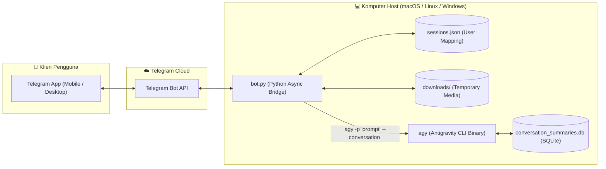

# Antigravity CLI (`agy`) - Telegram Bot Bridge `v0.1`

<p align="center">
  <a href="README.md">English</a> •
  <b>Bahasa Indonesia</b>
</p>

<p align="center">
  <a href="https://github.com/fritzuu/agy-telegrambot/releases"></a>
  <a href="https://www.python.org/"></a>
  <a href="LICENSE"></a>
  <a href="https://github.com/fritzuu/agy-telegrambot/issues"></a>
  <a href="https://t.me/BotFather"></a>
</p>

Bridge cerdas dua arah untuk menghubungkan percakapan **Telegram** langsung dengan **Google Antigravity CLI (`agy`)**. Memungkinkan Anda mengontrol, memprogram, dan berdiskusi dengan AI coding agent Antigravity langsung dari Telegram (ponsel maupun desktop) secara persisten dan interaktif.

---

## 🏛️ Arsitektur Sistem



---

## 🌟 Fitur Utama (v0.1.0)

1. **Multi-turn Session Memory (Percakapan Bersambung)**
   - Setiap user Telegram memiliki sesi percakapan persisten (`sessions.json` yang disinkronkan langsung dengan database internal Antigravity `conversation_summaries.db`).
   - Bot mengingat konteks pembicaraan sebelumnya sehingga Anda dapat berdialog secara alami tanpa kehilangan konteks.

2. **Dukungan Media Dua Arah (Two-Way Image Support)**
   - **Kirim Gambar ke Agent**: Kirim foto dari Telegram (dengan atau tanpa caption). Bot otomatis menyimpannya di folder `downloads/` dan memberikannya ke `agy` untuk dianalisis.
   - **Terima Gambar dari Agent**: Jika Antigravity menghasilkan gambar, diagram, atau merujuk path file lokal (`` atau path gambar lokal), bot akan mendeteksinya dan otomatis mengunggah gambar tersebut ke chat Telegram.

3. **Status Typing Real-Time**
   - Menampilkan indikator status *typing...* di Telegram selama Antigravity CLI sedang memproses prompt, menjalankan tools, atau menganalisis kode.

4. **Smart Message Chunking**
   - Secara otomatis memecah jawaban panjang dari agent agar tidak terpotong oleh batasan 4096 karakter dari API Telegram.

5. **Eksekusi Otomatis (Autonomous Execution)**
   - Dilengkapi opsi `AUTO_APPROVE_TOOLS=true` (`--dangerously-skip-permissions`) di file konfigurasi, memungkinkan agen menjalankan perintah shell atau tool tanpa terhambat prompt konfirmasi manual di terminal.

6. **Command Navigasi Bawaan**:
   - `/start` — Memulai interaksi & panduan ringkas.
   - `/new` atau `/reset` — Menghapus riwayat percakapan aktif dan memulai sesi baru.
   - `/session` — Memeriksa Conversation ID aktif dari Antigravity.
   - `/sendimg <path>` — Mengirimkan file gambar tertentu dari komputer host langsung ke Telegram.
   - `/help` — Menampilkan bantuan dan daftar fitur.

---

## 📋 Persyaratan Sistem

- **Python**: Versi 3.10 atau lebih baru.
- **Package Manager**: [uv](https://docs.astral.sh/uv/) (direkomendasikan) atau `pip` standar.
- **Antigravity CLI**: Executable `agy` sudah terpasang dan terautentikasi di sistem host.
- **Akun Telegram**: Untuk membuat bot via `@BotFather`.

---

## 1. Cara Menghubungkan ke Telegram

Ikuti langkah-langkah berikut untuk mendapatkan API Token bot Telegram Anda:

1. **Buka Telegram** dan cari akun resmi **[@BotFather](https://t.me/BotFather)**.
2. Kirim pesan:
   ```text
   /newbot
   ```
3. BotFather akan meminta:
   - **Nama Bot**: Misal `My Antigravity Assistant`
   - **Username Bot**: Harus unik dan berakhiran `bot` (contoh: `my_antigravity_bot` atau `agy_bridge_bot`).
4. Setelah selesai, BotFather akan memberikan **HTTP API Token** seperti contoh:
   ```text
   7123456789:ABCdefGhIJKlmNoPQRsTUVwxyZ1234567
   ```
5. Salin token tersebut, lalu buat file `.env` dari template:
   ```bash
   cp .env.example .env
   ```
   Isi file `.env`:
   ```env
   TELEGRAM_BOT_TOKEN="7123456789:ABCdefGhIJKlmNoPQRsTUVwxyZ1234567"
   AUTO_APPROVE_TOOLS=true
   ```

> [!CAUTION]
> Jangan pernah membagikan atau mengunggah file `.env` yang berisi token Telegram Anda ke repositori publik!

---

## 2. Cara Menghubungkan ke Antigravity CLI (`agy`) di Semua Platform OS

Bot ini berkomunikasi langsung dengan binary `agy` pada mesin host Anda. Pastikan `agy` sudah terpasang dan dapat dijalankan di terminal.

### 🍎 macOS
1. **Verifikasi Binary**:
   Secara default terpasang di `~/.local/bin/agy` atau melalui PATH sistem:
   ```bash
   which agy
   # atau
   ls -la ~/.local/bin/agy
   ```
2. **Tambahkan ke PATH** (jika belum terdaftar):
   Tambahkan ke `~/.zshrc` (atau `~/.bash_profile`):
   ```bash
   export PATH="$HOME/.local/bin:$PATH"
   ```
   Lalu jalankan `source ~/.zshrc`.
3. **Autentikasi**:
   Pastikan login CLI sudah aktif:
   ```bash
   agy -p "halo"
   ```

---

### 🐧 Linux (Ubuntu / Debian / Fedora / Arch)
1. **Verifikasi Binary**:
   Periksa ketersediaan `agy`:
   ```bash
   which agy
   ```
   Pastikan permission file executable:
   ```bash
   chmod +x ~/.local/bin/agy
   ```
2. **Tambahkan ke PATH**:
   Tambahkan baris berikut ke `~/.bashrc`:
   ```bash
   export PATH="$HOME/.local/bin:$PATH"
   ```
   Jalankan `source ~/.bashrc`.
3. **Uji Coba**:
   ```bash
   agy -p "cek status"
   ```

---

### 🪟 Windows

Tersedia dua metode konfigurasi:

#### Opsi A: Menggunakan WSL 2 (Sangat Direkomendasikan)
Menjalankan bot dan `agy` di dalam **Windows Subsystem for Linux (WSL 2)** memberikan stabilitas terbaik dan kompatibilitas 100% identik dengan Unix:
1. Buka terminal WSL (misalnya Ubuntu).
2. Clone dan jalankan bot sesuai panduan Linux di atas.

#### Opsi B: Native Windows (PowerShell / Command Prompt)
1. **Tambahkan `agy.exe` ke Environment Variables**:
   - Tambahkan direktori instalasi `agy.exe` (misalnya `%USERPROFILE%\.local\bin`) ke variabel `PATH`.
   - Buka PowerShell baru dan uji:
     ```powershell
     agy --version
     ```
2. **Setup Virtual Environment**:
   ```powershell
   python -m venv .venv
   .\.venv\Scripts\Activate.ps1
   pip install "python-telegram-bot[job-queue]" python-dotenv
   ```
3. **Jalankan Bot**:
   ```powershell
   python bot.py
   ```

---

## 3. Instalasi & Menjalankan Bot

### Langkah Cepat (macOS / Linux)
Gunakan launcher otomatis bawaan `run.sh`:
```bash
chmod +x run.sh
./run.sh
```

### Langkah Manual (Semua Platform)
```bash
python3 -m venv .venv
source .venv/bin/activate  # Di Windows: .\.venv\Scripts\Activate.ps1
pip install "python-telegram-bot[job-queue]" python-dotenv
python3 bot.py
```

---

## 4. Menjalankan di Latar Belakang (Background Service)

Agar bot tetap aktif saat jendela terminal ditutup:

- **Menggunakan `tmux` (Direkomendasikan)**:
  ```bash
  tmux new -s agy-bot
  ./run.sh
  # Tekan Ctrl+B lalu D untuk detach
  # Kembali ke sesi: tmux attach -t agy-bot
  ```
- **Menggunakan `nohup`**:
  ```bash
  nohup ./run.sh > bot.log 2>&1 &
  ```
- **Menggunakan `pm2`**:
  ```bash
  pm2 start run.sh --name "agy-telegram-bot"
  pm2 save
  ```

---

## 5. Ringkasan Perintah Telegram

| Perintah | Deskripsi |
| :--- | :--- |
| `/start` | Menampilkan pesan sambutan dan status bot |
| `/new` atau `/reset` | Mengosongkan riwayat percakapan aktif dan memulai sesi baru |
| `/session` | Menampilkan `conversation_id` aktif yang digunakan oleh Antigravity |
| `/sendimg <path>` | Mengirimkan file gambar lokal dari komputer host ke chat Telegram |
| `/help` | Menampilkan panduan dan instruksi penggunaan |

---

## 📁 Struktur Direktori

```text
agy-telegram-bot/
├── .github/              # Issue & PR templates
├── .env.example          # Template konfigurasi environment
├── .gitignore            # Aturan pengecualian file Git
├── CHANGELOG.md          # Riwayat perubahan per versi
├── CONTRIBUTING.md       # Panduan kontribusi
├── CODE_OF_CONDUCT.md    # Kode etik komunitas
├── LICENSE               # Lisensi MIT
├── README.md             # Dokumentasi utama (English)
├── README.id.md          # Dokumentasi Bahasa Indonesia
├── bot.py                # Core application bridge Telegram <-> Antigravity CLI
├── run.sh                # Launcher script otomatis dengan uv
├── sessions.json         # Pemetaan user ID Telegram ke conversation ID
└── downloads/            # Direktori sementara foto dari Telegram user
```

---

## 🤝 Kontribusi & Komunitas

Kontribusi sangat terbuka! Silakan baca [CONTRIBUTING.md](CONTRIBUTING.md) untuk panduan alur kerja, standar kode, dan cara membuka Pull Request. Harap patuhi standar etika di [CODE_OF_CONDUCT.md](CODE_OF_CONDUCT.md).

---

## 📄 Lisensi

Didistribusikan di bawah Lisensi MIT. Lihat [`LICENSE`](LICENSE) untuk informasi lebih lanjut.
