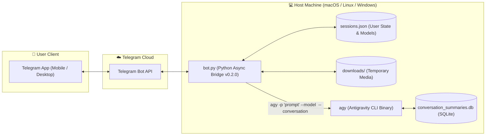

# Antigravity CLI (`agy`) - Telegram Bot Bridge `v0.2.0`

<p align="center">
  <b>English</b> •
  <a href="README.id.md">Bahasa Indonesia</a>
</p>

<p align="center">
  <a href="https://github.com/fritzuu/agy-telegrambot/releases"></a>
  <a href="https://www.python.org/"></a>
  <a href="LICENSE"></a>
  <a href="https://github.com/fritzuu/agy-telegrambot/issues"></a>
  <a href="https://t.me/BotFather"></a>
</p>

An intelligent, bidirectional bridge connecting **Telegram** chats directly with **Google Antigravity CLI (`agy`)**. Seamlessly control, interact with, and instruct your local AI coding agent on the go from your phone or desktop via Telegram.

---

## 🏛️ System Architecture



---

## 🌟 Key Features (v0.2.0)

1. **Interactive Model Selection (`/model`)**
   - Switch AI models on the fly via an interactive Telegram Inline Keyboard:
     - `Gemini 3.8 Flash (High / Medium / Low)`
     - `Claude Sonnet 4.6 (Thinking)`
     - `Claude Opus 4.6 (Thinking)`
     - `GPT-OSS 120B (Medium)`
   - Preferences are saved per-user and dynamically injected via `--model`.

2. **Real-time Task Cancellation (`/stop` & Inline Button)**
   - Dynamic `🛑 Batalkan Proses` button appears under the processing message.
   - Command `/stop` or `/cancel` terminates active CLI subprocesses immediately.

3. **Quick Actions Hub (`/menu`)**
   - Instant inline dashboard for routine actions: `📊 Git Status`, `🔄 Reset Session`, `🔍 Host Info`, and `ℹ️ Session/Model Info`.

4. **Access Control & Whitelist Guard (`ALLOWED_TELEGRAM_USERS`)**
   - Restrict access to authorized Telegram User IDs in `.env` to prevent unauthorized shell executions.

5. **Multi-turn Session Memory & Continuity**
   - Each Telegram user retains persistent conversation context (`sessions.json` synced with Antigravity SQLite database `conversation_summaries.db`).

6. **Bidirectional Media Processing**
   - Send photos from Telegram to `agy`, and receive generated diagrams or screenshots automatically.

7. **Smart Chunking & Safe Markdown Parsing**
   - Automatic slicing of messages exceeding Telegram's 4096-character limit with resilient plain text fallback if formatting syntax fails.

---

## 📋 Prerequisites

- **Python**: Version 3.10 or higher.
- **Package Manager**: [uv](https://docs.astral.sh/uv/) (recommended) or standard `pip`.
- **Antigravity CLI**: `agy` binary installed and authenticated on your host.
- **Telegram Account**: To create and configure a bot via `@BotFather`.

---

## 1. Connecting to Telegram

1. Open Telegram and search for the official **[@BotFather](https://t.me/BotFather)**.
2. Send:
   ```text
   /newbot
   ```
3. Set your bot name and username (e.g., `my_antigravity_bot`).
4. Copy the generated **HTTP API Token**.
5. Create your `.env` configuration file:
   ```bash
   cp .env.example .env
   ```
6. Configure `.env`:
   ```env
   TELEGRAM_BOT_TOKEN="7123456789:ABCdefGhIJKlmNoPQRsTUVwxyZ1234567"
   AUTO_APPROVE_TOOLS=true
   ALLOWED_TELEGRAM_USERS="your_telegram_user_id"
   ```

> [!CAUTION]
> Never share or commit your `.env` file containing your Telegram Bot Token to public repositories!

---

## 2. Connecting to Antigravity CLI (`agy`) Across Operating Systems

The bridge executes `agy` commands directly on your host operating system. Ensure `agy` is installed and accessible in your shell.

### 🍎 macOS
1. **Locate Binary**: By default located at `~/.local/bin/agy` or available in your global `PATH`.
2. **Add to PATH**:
   ```bash
   export PATH="$HOME/.local/bin:$PATH"
   ```
   Add to `~/.zshrc` and run `source ~/.zshrc`.
3. **Verify**:
   ```bash
   agy -p "hello"
   ```

---

### 🐧 Linux (Ubuntu / Debian / Fedora / Arch)
1. **Verify Binary**:
   ```bash
   chmod +x ~/.local/bin/agy
   which agy
   ```
2. **Add to PATH**:
   Add to `~/.bashrc`:
   ```bash
   export PATH="$HOME/.local/bin:$PATH"
   ```
   Reload with `source ~/.bashrc`.

---

### 🪟 Windows

- **WSL 2 (Highly Recommended)**: Run inside WSL (Ubuntu) following the Linux guide.
- **Native Windows**: Add `agy.exe` directory to system `Path`, create virtual environment in PowerShell, and run `python bot.py`.

---

## 3. Installation & Quickstart

```bash
# Clone repository
git clone https://github.com/fritzuu/agy-telegrambot.git
cd agy-telegrambot

# Automated launcher (macOS / Linux)
chmod +x run.sh
./run.sh
```

---

## 4. Running as a Background Daemon

- **Using `tmux` (Recommended)**:
  ```bash
  tmux new -s agy-bot
  ./run.sh
  # Ctrl+B then D to detach
  ```
- **Using `pm2`**:
  ```bash
  pm2 start run.sh --name "agy-telegram-bot"
  pm2 save
  ```

---

## 5. Command Reference

| Command | Description |
| :--- | :--- |
| `/start` | Displays welcome message, active model, and guide |
| `/model` | **[New in v0.2.0]** Interactive AI model selection menu |
| `/menu` | **[New in v0.2.0]** Quick actions dashboard (Git status, host info, reset) |
| `/stop` / `/cancel` | **[New in v0.2.0]** Terminates the currently executing task |
| `/new` or `/reset` | Clears active conversation memory to start fresh |
| `/session` | Shows the active Antigravity `conversation_id` |
| `/help` | Displays usage instructions |

---

## 📁 Repository Structure

```text
agy-telegram-bot/
├── .github/              # Issue & PR templates
├── .env.example          # Environment variable template
├── .gitignore            # Git exclusion rules
├── CHANGELOG.md          # Release version history
├── CONTRIBUTING.md       # Contribution guidelines
├── CODE_OF_CONDUCT.md    # Contributor Covenant Code of Conduct
├── LICENSE               # MIT License
├── README.md             # Primary documentation (English)
├── README.id.md          # Indonesian documentation (Bahasa Indonesia)
├── bot.py                # Core async bridge (Telegram <-> Antigravity CLI v0.2.0)
├── run.sh                # Automated launcher with uv
├── sessions.json         # User state and model preference mapping
└── downloads/            # Temporary media storage for Telegram images
```

---

## 🤝 Contributing

Contributions are welcomed! Please read our [CONTRIBUTING.md](CONTRIBUTING.md) and adhere to the [CODE_OF_CONDUCT.md](CODE_OF_CONDUCT.md).

---

## 📄 License

This project is licensed under the MIT License - see the [`LICENSE`](LICENSE) file for details.
