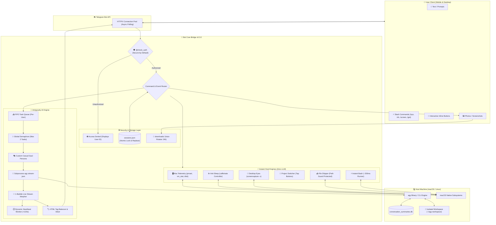

# Antigravity CLI (`agy`) - Telegram Bot Bridge `v0.3.0`

<p align="center">
  <b>English</b> •
  <a href="README.id.md">Bahasa Indonesia</a>
</p>

<p align="center">
  <a href="https://github.com/fritzuu/agy-telegrambot/releases"></a>
  <a href="https://www.python.org/"></a>
  <a href="LICENSE"></a>
  <a href="https://github.com/fritzuu/agy-telegrambot/issues"></a>
  <a href="https://t.me/BotFather"></a>
</p>

An intelligent, bidirectional bridge connecting **Telegram** chats directly with **Google Antigravity CLI (`agy`)**. Seamlessly control, interact with, and instruct your local AI coding agent on the go from your phone or desktop via Telegram.

---

## 🏛️ System Architecture & Workflow (v0.3.0)



---

## 🌟 Key Features (v0.3.0)

### 📱 1. Mobile Companion Suite (Away-from-Mac)
Built specifically for seamless usage while commuting, lying in bed, or away from your laptop:
- **Mac Telemetry Hub (`/sys` or `/status`)**: Monitor battery percentage, charging state, remaining time, physical RAM usage, free SSD storage, CPU load averages (1/5/15m), and host uptime.
- **Anti-Sleep Controller (`/caffeinate [on/off]`)**: Keep your Mac awake in the background while traveling or running lengthy tasks.
- **Remote Desktop Eyes (`/screen` or `/screenshot`)**: Silently capture your Mac desktop and receive high-resolution screenshots in Telegram.
- **Mobile Project Switcher (`/projects` or `/fav`)**: Switch active project workspaces with a single tap on interactive inline buttons.
- **Direct File Delivery (`/get <file>`)**: Download generated artifacts, CSV reports, scripts, or PDFs from your Mac straight to your mobile device as Telegram Documents.
- **Instant Bash Runner (`/sh <cmd>` or `$ <cmd>`)**: Execute lightweight terminal commands in ~200ms in the active workspace without waiting for an LLM turn.

### 🎭 2. Isolated Workspace Routing & Casual Persona
- **Complete Isolation**: Defaults to `~/agy-workspace/` with an independent `GEMINI.md` context file, preventing context leaks during `/new` resets.
- **Mobile Workspace Navigation**: Inspect your current directory with `/pwd` and switch directories with `/cd <path>`.
- **Casual & Humorous Persona**: Features a chillout personal assistant persona ("gue-lu"), natural humor, friendly roasting on coding typos, and concise mobile-optimized output.

### 🛡️ 3. Industrial Hardened Security
- **Secure by Default**: Automatically locks down if `ALLOWED_TELEGRAM_USERS` is unconfigured in `.env`. Unregistered users are presented with their numeric User ID for easy onboarding.
- **Anti-Credential Exfiltration**: Protects private keys and secret dotfiles (`.ssh`, `.env`, `.aws`, `.git`, `id_rsa`, `*.pem`, `*.key`) from `/get` downloads.
- **Atomic Session File**: Serializes updates using `asyncio.Lock()` and atomic `os.replace` to prevent file corruption.
- **Zombie Process Elimination**: Employs an `await proc.wait()` timeout watchdog on all terminations, eliminating UNIX `<defunct>` zombie processes.
- **HTML Tag Balancer**: Automatically balances open and closed HTML formatting tags across 4000-character chunks to prevent Telegram API parsing exceptions.
- **Auto-Cleanup Cache**: Rotates cached photo downloads in `downloads/` (24h retention, max 30 files).

### ⚡ 4. Live Streaming & Queue Management
- **Live 1-Bubble Streaming**: Streams token output into a single message bubble (debounced to 1.5s) to avoid rate limits.
- **Asynchronous FIFO Queue**: Sequential message execution per-user using `asyncio.Queue`.
- **Interactive Model Selection (`/model`)**: Switch between Gemini Flash, Claude Sonnet 4.6, Claude Opus 4.6, and GPT-OSS on the fly.
- **Real-Time Task Cancellation (`/stop` & inline button)**: Terminate runaway processes with one tap.

---

## 📋 Prerequisites

- **Python**: Version 3.10 or higher.
- **Package Manager**: [uv](https://docs.astral.sh/uv/) (recommended) or standard `pip`.
- **Antigravity CLI**: `agy` binary installed and authenticated on your host.
- **Telegram Account**: To create and configure a bot via `@BotFather`.

---

## 1. Connecting to Telegram

1. Open Telegram and search for the official **[@BotFather](https://t.me/BotFather)**.
2. Send:
   ```text
   /newbot
   ```
3. Set your bot name and username (e.g., `my_antigravity_bot`).
4. Copy the generated **HTTP API Token**.
5. Create your `.env` configuration file:
   ```bash
   cp .env.example .env
   ```
6. Configure `.env`:
   ```env
   TELEGRAM_BOT_TOKEN="7123456789:ABCdefGhIJKlmNoPQRsTUVwxyZ1234567"
   AUTO_APPROVE_TOOLS=true
   ALLOWED_TELEGRAM_USERS="your_telegram_user_id"
   ```

> [!CAUTION]
> Never share or commit your `.env` file containing your Telegram Bot Token to public repositories!

---

## 2. Connecting to Antigravity CLI (`agy`) Across Operating Systems

The bridge executes `agy` commands directly on your host operating system. Ensure `agy` is installed and accessible in your shell.

### 🍎 macOS
1. **Locate Binary**: By default located at `~/.local/bin/agy` or available in your global `PATH`.
2. **Add to PATH**:
   ```bash
   export PATH="$HOME/.local/bin:$PATH"
   ```
   Add to `~/.zshrc` and run `source ~/.zshrc`.
3. **Verify**:
   ```bash
   agy -p "hello"
   ```

---

### 🐧 Linux (Ubuntu / Debian / Fedora / Arch)
1. **Verify Binary**:
   ```bash
   chmod +x ~/.local/bin/agy
   which agy
   ```
2. **Add to PATH**:
   Add to `~/.bashrc`:
   ```bash
   export PATH="$HOME/.local/bin:$PATH"
   ```
   Reload with `source ~/.bashrc`.

---

### 🪟 Windows

- **WSL 2 (Highly Recommended)**: Run inside WSL (Ubuntu) following the Linux guide.
- **Native Windows**: Add `agy.exe` directory to system `Path`, create virtual environment in PowerShell, and run `python bot.py`.

---

## 3. Installation & Quickstart

```bash
# Clone repository
git clone https://github.com/fritzuu/agy-telegrambot.git
cd agy-telegrambot

# Automated launcher (macOS / Linux)
chmod +x run.sh
./run.sh
```

---

## 4. Running as a Background Daemon

- **Using `tmux` (Recommended)**:
  ```bash
  tmux new -s agy-bot
  ./run.sh
  # Ctrl+B then D to detach
  ```
- **Using `pm2`**:
  ```bash
  pm2 start run.sh --name "agy-telegram-bot"
  pm2 save
  ```

---

## 5. Command Reference (v0.3.0)

| Command | Description |
| :--- | :--- |
| `/sys` or `/status` | **[New in v0.3.0]** Real-time Mac Telemetry (Battery, RAM, SSD, CPU load, uptime) |
| `/caffeinate [on/off]`| **[New in v0.3.0]** macOS Anti-Sleep Mode to keep host awake on the go |
| `/screen` / `/screenshot` | **[New in v0.3.0]** Silently capture macOS desktop screenshot sent to Telegram |
| `/projects` or `/fav`| **[New in v0.3.0]** Interactive inline project switcher with bookmarking |
| `/get <path>` | **[New in v0.3.0]** Download files, artifacts, PDFs from Mac to mobile (credential protected) |
| `/sh <cmd>` or `$ <cmd>`| **[New in v0.3.0]** Instant bash terminal (~200ms runner) in active workspace |
| `/pwd` | **[New in v0.3.0]** Check current active workspace directory path |
| `/cd <path>` | **[New in v0.3.0]** Manually switch active workspace directory |
| `/menu` | Quick Actions Hub (Git status, Telemetry, Screen, Settings) |
| `/model` | Interactive model selection menu (Gemini Flash, Claude Sonnet, Opus) |
| `/new` or `/reset` | Completely resets conversation memory for a fresh session |
| `/stop` or `/cancel` | Immediately terminates running CLI task and clears queue |
| `/session` | Shows active Antigravity `conversation_id` |
| `/start` | Displays welcome banner, active workspace, and quick start guide |
| `/help` | Displays comprehensive guide and usage instructions |

---

## 📁 Repository Structure

```text
agy-telegram-bot/
├── .github/              # Issue & PR templates
├── .env.example          # Environment variable template (Secure by Default)
├── .gitignore            # Git exclusion rules
├── CHANGELOG.md          # Release version history
├── CONTRIBUTING.md       # Contribution guidelines
├── CODE_OF_CONDUCT.md    # Contributor Covenant Code of Conduct
├── LICENSE               # MIT License
├── README.md             # Primary documentation (English)
├── README.id.md          # Indonesian documentation (Bahasa Indonesia)
├── bot.py                # Core async bridge (Telegram <-> Antigravity CLI v0.3.0)
├── run.sh                # Automated launcher with uv
├── sessions.json         # User state, model preferences & project bookmarks
└── downloads/            # Temporary media storage for Telegram images (auto-rotated)
```

---

## 🤝 Contributing

Contributions are welcomed! Please read our [CONTRIBUTING.md](CONTRIBUTING.md) and adhere to the [CODE_OF_CONDUCT.md](CODE_OF_CONDUCT.md).

---

## 📄 License

This project is licensed under the MIT License - see the [`LICENSE`](LICENSE) file for details.
